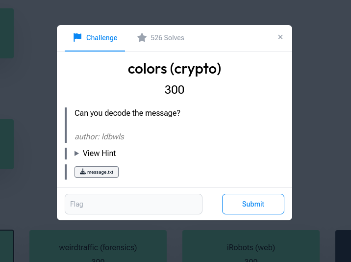
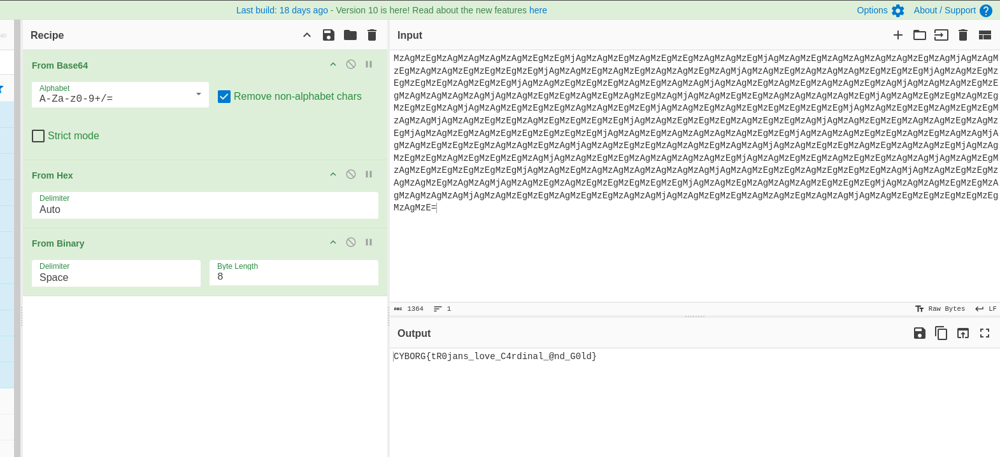

# colors

**Category:** Beginner · Crypto · **Points:** 300 · **Author:** ldbwls

← [Back to all challenges](../../README.md)



## Description

> Can you decode the message?

**File:** `message.txt`

## Solution

The message is not encrypted, just wrapped in **three layers of encoding**. The trick is recognising each layer from what its output looks like.

**Layer 1: Base64.** The file uses only `A–Z a–z 0–9 + /` and ends with `=` padding, which points to Base64:

```
MzAgMzEgMzAgMzAgMzAgMzAgMzEgMzEgMjAgMzAgMzEgMzAgMzEgMzEg...=
```

**Layer 2: Hex.** Decoding the Base64 gives pairs made only of `30`, `31` and `20`. Those are the hex codes for the ASCII characters `0`, `1` and a space:

```
30 31 30 30 30 30 31 31 20 30 31 30 31 31 30 30 ...
```

**Layer 3: Binary.** Decoding the hex gives 8-bit binary groups separated by spaces:

```
01000011 01011001 01000010 01001111 01010010 01000111 ...
   C        Y        B        O        R        G
```

Converting each byte to ASCII gives the flag.

### CyberChef recipe

`From Base64` → `From Hex` → `From Binary` (delimiter: Space, byte length: 8)



### Script

```python
import base64

layer2 = base64.b64decode(open("message.txt").read()).decode()   # hex
layer3 = bytes.fromhex(layer2.replace(" ", "")).decode()          # binary
print("".join(chr(int(b, 2)) for b in layer3.split()))
```

Full script: [`solve.py`](solve.py)

## Flag

```
CYBORG{tR0jans_love_C4rdinal_@nd_G0ld}
```

## Takeaway

Encoding is not encryption. When a decoded output contains only a few distinct values (here `30`, `31` and `20`), it's usually another encoding layer, not ciphertext.
