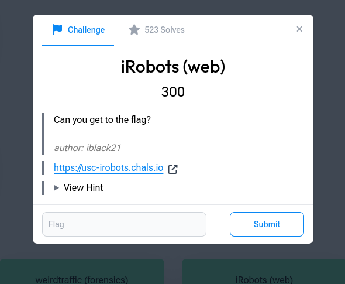

# iRobots

**Category:** Beginner · Web · **Points:** 300 · **Author:** iblack21

← [Back to all challenges](../../README.md)



## Description

> Can you get to the flag?

**Target:** `https://usc-irobots.chals.io`

## Solution

**1. Look at the site.** The home page only shows a password prompt, with no obvious way past it.

**2. Follow the name.** "iRobots" points straight at **`robots.txt`**, the file that tells search engine crawlers which paths not to index:

```bash
curl https://usc-irobots.chals.io/robots.txt
```

It contains a disallowed path:

```
Disallow: /hidden/flag.txt
```

**3. Visit the disallowed path.** `robots.txt` is only a request to crawlers; it doesn't block anyone. Requesting the path directly returns the flag in plain text:

```bash
curl https://usc-irobots.chals.io/hidden/flag.txt
```

## Flag

```
CYBORG{robots_txt_is_fun}
```

## Takeaway

`robots.txt` is public, and listing a path there advertises it. It is **not** access control. Sensitive files need real authentication, or shouldn't be on the web server at all. Checking `robots.txt` is also one of the first steps of web recon.
