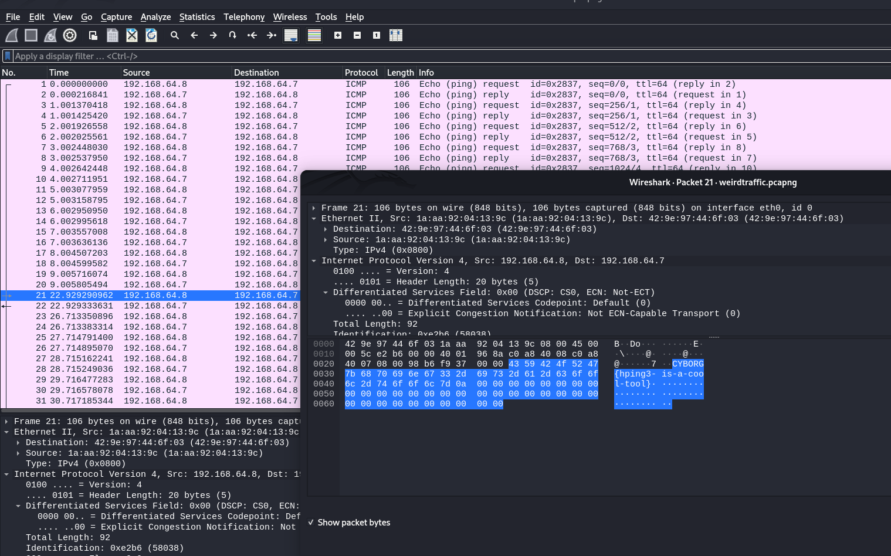

# weirdtraffic

**Category:** Beginner · Forensics · **Points:** 300

← [Back to all challenges](../../README.md)

## Description

**File:** [`weirdtraffic.pcapng`](weirdtraffic.pcapng), a packet capture of network traffic.

## Solution

**1. Get an overview.** Opening the capture in **Wireshark** shows only **ICMP echo (ping)** traffic between `192.168.64.8` and `192.168.64.7`, sent about once a second.

**2. Check the payloads.** Ping packets can carry arbitrary data. Almost every packet carries the same harmless payload:

```
Hello, World!
```

**3. Spot the odd one out.** The timing gives it away. Pings arrive every second until about 9 s, then there's a **13-second gap**, then **packet 21** arrives at 22.9 s. Its payload is different:



```
0020   .. .. .. .. .. .. .. .. .. .. 43 59 42 4f 52 47    ......CYBORG
0030   7b 68 70 69 6e 67 33 2d 69 73 2d 61 2d 63 6f 6f    {hping3-is-a-coo
0040   6c 2d 74 6f 6f 6c 7d 0a                            l-tool}.
```

### One-liner with tshark

Instead of clicking through packets, you can print every ICMP payload and look for the one that differs:

```bash
tshark -r weirdtraffic.pcapng -Y icmp -T fields -e frame.number -e data.data \
  | while read n d; do echo "$n $(echo "$d" | xxd -r -p | tr -d '\0')"; done
```

## Flag

```
CYBORG{hping3-is-a-cool-tool}
```

## Takeaway

The flag names the tool: **hping3** can craft packets with custom payloads, such as `hping3 --icmp -E file`. That makes ICMP a classic covert channel for slipping data out of a network. When looking for exfiltration, check payload content and timing, not just protocols and ports.
