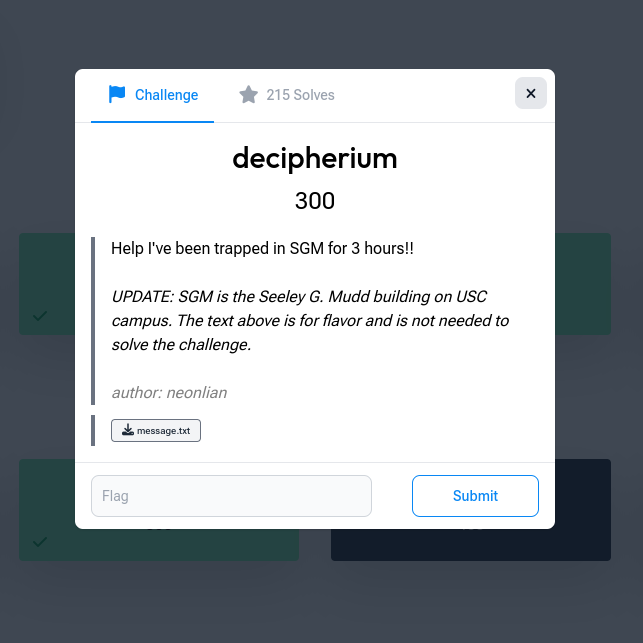
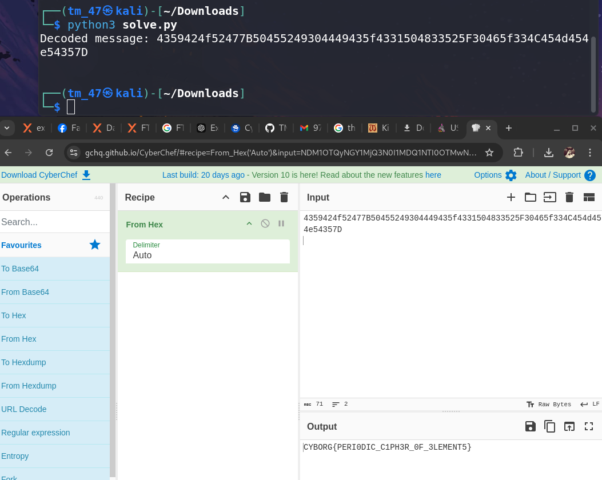

# decipherium

**Category:** Crypto · **Points:** 300 · **Author:** neonlian

← [Back to all challenges](../../README.md)



## Description

> Help I've been trapped in SGM for 3 hours!!
>
> *UPDATE: SGM is the Seeley G. Mudd building on USC campus. The text above is for flavor and is not needed to solve the challenge.*

**File:** `message.txt`

```
TeSbILaTeSnTeNoISnTeCsCsDyICdTeIISnTeLaSbCdTeTeTeLaTeSbINoTeSbSbInICdTeBaSbSbISnIYbSbCdTeXeINoSbSbTeHoTeITeFmTeITeMdITeSbICsEr
```

## Solution

The capital letters mark where each piece starts: `Te`, `Sb`, `I`, `La`, `Te`… These are **chemical element symbols**, and the name *decipher-ium* confirms the periodic table theme.

**1. Split into element symbols.** Read left to right, preferring two-letter symbols (`Te`) over one-letter ones (`I`):

```
Te Sb I La Te Sn Te No I Sn ...
```

**2. Replace each element with its atomic number**, then read that number as an ASCII code:

| Element | Atomic number | ASCII |
|---------|---------------|-------|
| Te | 52 | `4` |
| Sb | 51 | `3` |
| I  | 53 | `5` |
| La | 57 | `9` |
| No | 102 | `f` |
| Dy | 66 | `B` |

The atomic numbers all fall in the ranges for the digits `0–9` and the letters `a–f` / `A–F`, so the result is a **hex string**:

```
4359424f52477B50455249304449435f4331504833525F30465f334C454d454e54357D
```

**3. Decode the hex** (`43` = `C`, `59` = `Y`, `42` = `B` …) to get the flag:



Full script, which does all three steps: [`solve.py`](solve.py)

```bash
python3 solve.py
```

## Flag

```
CYBORG{PERI0DIC_C1PH3R_0F_3LEMENT5}
```
