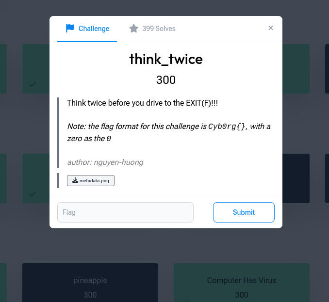

# think_twice

**Category:** Forensics · **Points:** 300 · **Author:** nguyen-huong

← [Back to all challenges](../../README.md)



## Description

> Think twice before you drive to the EXIT(F)!!!
>
> *Note: the flag format for this challenge is `Cyb0rg{}`, with a zero as the `0`.*

**File:** [`metadata.png`](metadata.png)


## Solution

The description holds both hints:

- **"EXIT(F)"** → **EXIF**: look at the image's metadata, not its pixels.
- **"Think twice"** → whatever we find is encoded **twice**.

**1. Read the metadata** with exiftool:

```bash
exiftool metadata.png
```

Most tags are normal camera and colour-profile data, but the **`Software`** tag is wrong. It should name a program, and instead it holds a Base64-looking string:

```
Software                        : UTNsaU1ISm5lMDFqUTJGeWRHaDVmU0E9
```

**2. Decode it once:**

```bash
$ echo 'UTNsaU1ISm5lMDFqUTJGeWRHaDVmU0E9' | base64 -d
Q3liMHJne01jQ2FydGh5fSA=
```

That's still Base64.

**3. Decode it twice** (think twice):

```bash
$ echo 'Q3liMHJne01jQ2FydGh5fSA=' | base64 -d
Cyb0rg{McCarthy}
```

Full script: [`solve.py`](solve.py)

## Flag

```
Cyb0rg{McCarthy}
```

## Takeaway

Image metadata is an easy place to hide data, and it's often missed because it isn't visible. Running `exiftool` (or `exiftool -a -G1` for every tag) is a standard first step for any image in a forensics challenge.
