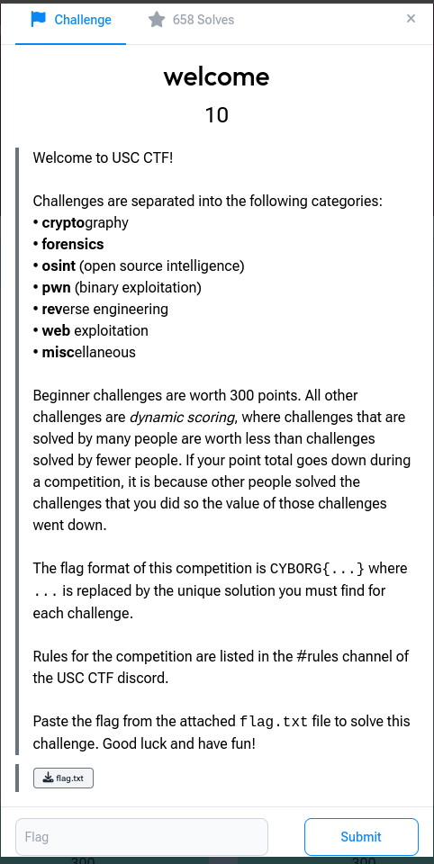

# welcome

**Category:** Welcome · **Points:** 10 · **Solves:** 658

← [Back to all challenges](../README.md)



## Description

The opening challenge explains how the event works:

- **Categories:** crypto, forensics, OSINT, pwn, reverse engineering, web and misc.
- **Scoring:** beginner challenges are a fixed 300 points; all others use **dynamic scoring**, so a challenge is worth less the more teams solve it.
- **Flag format:** `CYBORG{...}`

The challenge comes with one file, `flag.txt`.

## Solution

`flag.txt` contains the flag in plain text:

```bash
cat flag.txt
```

## Flag

```
CYBORG{lets_go}
```
